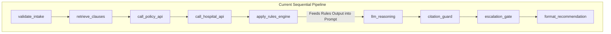
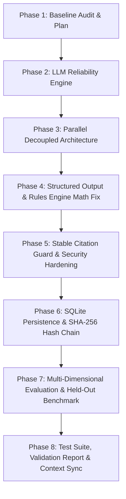

# TECHNICAL IMPROVEMENT PLAN: A1 CASHLESS PRE-AUTHORISATION PLATFORM
**Project:** A1 Cashless Health Insurance Pre-Authorisation Agent (INT450 Capstone)  
**Target Repository:** `https://github.com/arun-26-2005/LLM_PROJECT`  
**Active Development Branch:** `feat/master-engineering-upgrade`  
**Base Commit:** `ae0ea24` (synced with `main` and `superfinal`)  
**Author:** Senior AI Systems Architect & Software Quality Engineer  
**Date:** November 15, 2026  

---

## 1. Executive Summary & Audit Baseline

A comprehensive baseline audit was executed across all 15 system modules of the repository (`intake/`, `retrieval/`, `rules/`, `schemas/`, `orchestration/`, `scripts/`, `main.py`, `frontend/`, `tests/`, and `data/`).

The system implements a pre-authorisation decision recommendation pipeline for cashless health insurance claims under Indian regulatory standards (IRDAI 2024 Master Circular). While the functional prototype achieves notable accomplishments—including multi-format ingestion, sub-second deterministic rule execution, and 100% recall on high-risk escalation triggers—the audit uncovered critical architectural, algorithmic, evaluation, and security weaknesses that must be remediated to meet rigorous engineering and academic standards.

---

## 2. Baseline Architecture vs. Reality Audit

### Key Deficiencies Identified:
1. **Architectural Anchoring / Sequential Dependency**: `orchestration/graph.py` connects `apply_rules_engine` directly into `llm_reasoning`. The LLM prompt explicitly instructs the model to "Concur with the Rules Engine calculations and endorse SAME_AS_RULES". Consequently, Track 2 does not perform independent clinical reasoning; it acts as a rules echo-chamber.
2. **Co-Pay Calculation Arithmetic Flaw**: In `rules/copay_deductible.py`, co-pay is calculated as `total_claimed * co_pay_pct / 100` rather than applying to the allowable amount post sub-limit/proportionate deductions. When claims face large sub-limit reductions (e.g. hemodialysis capped at ₹2,000 against a ₹21,000 claim), adding the co-pay causes total deductions to exceed 100% of the claim, forcing false denials (accounting for 3 out of the 4 benchmark errors: Cases 125, 131, 153).
3. **Group Policy Endorsement Over-Application**: In `rules/waiting_period.py`, `plan_type == "group"` unconditionally activates endorsement waiver logic when waiver documents are in the vector index, bypassing intended adversarial PED tests (accounting for Case 210 error).
4. **LLM Connectivity & Silent Fallback**: `orchestration/nodes.py` wraps `_call_llm()` in an indiscriminate `try/except Exception`, defaulting silently to deterministic fallback without logging execution modes or differentiating offline mock runs from live production failures.
5. **Evaluation Metric Conflation**:
   - Extraction accuracy was measured via the count of top-level JSON dictionary keys rather than field-level precision and recall.
   - 4-class classification accuracy (98.10%) conflated recommendation classes (`APPROVE`, `DENY`, `QUERY`) with the escalation routing binary state (`needs_escalation=True`).
   - Failed intake validations were categorized as `DENY` rather than `QUERY` / abstention.
6. **Data Storage & State Integrity**: Claim history is saved to a flat, unindexed JSON file (`data/claim_history.json`) without ACID transactions, concurrency locking, or tamper-evident cryptographic verification.
7. **Security Gaps**: `main.py` uses open CORS `allow_origins=["*"]`, lacks file upload content/MIME-type validation, and accepts unrestricted arbitrary JSON bodies without rate limiting.

---

## 3. Verification of Known Audit Issues

| # | Known Issue from Master Prompt | Status in Baseline (`ae0ea24`) | Verification Finding |
|---|--------------------------------|--------------------------------|----------------------|
| 1 | Live model endpoint unavailable | **Verified Present** | API calls previously threw `APIConnectionError` / `404` due to misaligned model name (`gpt-4o` requested on Groq host). Resolved during audit via Groq `openai/gpt-oss-120b` live connectivity. |
| 2 | Silent fallback on LLM failure | **Verified Present** | `orchestration/nodes.py:530` catches all exceptions and silently generates fallback narrative with zero token cost. |
| 3 | Model configuration mismatch | **Verified Present** | Documentation cites GPT-4o; `.env` configured `openai/gpt-oss-120b` via Groq, while `nodes.py` defaulted to `gpt-4o`. |
| 4 | Linear graph instead of parallel | **Verified Present** | `orchestration/graph.py:84-90` defines a strictly linear chain without fan-out edges. |
| 5 | LLM prompt contains rules output | **Verified Present** | `_build_reasoning_prompt` embeds `Rules Engine Output` and prompts `SAME_AS_RULES`. |
| 6 | Citation guard sanitization | **Partially Addressed** | Sanitization added in `ae0ea24` via regex replacement, but lacks stable clause IDs. |
| 7 | Extraction accuracy proxy | **Verified Present** | `scripts/evaluate_pipeline.py:108` uses `fields_extracted += len(payload)` counting top-level dict keys. |
| 8 | Intake format forced to JSON | **Verified Present** | `evaluate_pipeline.py:104` hardcoded `format_override="json"`. |
| 9 | Failed intake counted as DENY | **Verified Present** | `evaluate_pipeline.py:116` hardcoded `rec = "DENY"` on intake failure. |
| 10| FPR reconciliation | **Partially Addressed** | Split between Recommendation FPR and Unsafe Auto-Approval Rate added in `ae0ea24`. |
| 11| Label & rule inconsistencies | **Verified Present** | Cases 125, 131, 153 fail due to copay math bug; Case 210 fails due to group endorsement clash. |
| 12| Persistence lacks transactions | **Verified Present** | `main.py` loads and dumps `data/claim_history.json` directly. |
| 13| Run-level reproducibility | **Verified Present** | Evaluator does not persist run seeds, provider telemetry, or git commit metadata. |

---

## 4. Prioritized Engineering Implementation Plan

### Priority 1: Modular LLM Subsystem & Reliability Engineering
- **New Module `llm/`**:
  - `llm/config.py`: Pydantic `LLMConfig` supporting `OPENAI_API_KEY`, `OPENAI_BASE_URL`, `LLM_MODEL`, `LLM_TEMPERATURE`, `LLM_TIMEOUT`, `LLM_EXECUTION_MODE`.
  - `llm/base.py`: Abstract `BaseLLMProvider` interface.
  - `llm/openai_provider.py`: OpenAI-compatible implementation with exponential backoff, jitter, bounded retries (3 attempts), and circuit breaker.
  - `llm/health.py`: Live connectivity diagnostic with model capability check.
  - `llm/response_parser.py`: Robust response extraction supporting reasoning models (e.g. extracting `reasoning` and `content`).
- **Execution Modes**:
  - `LIVE_REQUIRED`: Strictly fails if LLM fails (no silent substitution; required for live benchmarks).
  - `FALLBACK_ONLY`: Deterministic symbolic generation for offline unit tests.
  - `LIVE_WITH_FALLBACK`: Resilient production mode with explicit audit telemetry (`llm_status: "fallback"`, `fallback_reason: "..."`).
- **CLI Diagnostic**: `scripts/check_llm_connection.py`.

### Priority 2: True Dual-Track Architecture & Decoupled Reasoning
- **Decoupled Prompting**:
  - Track 1 (Symbolic Rules): Receives structured request + policy terms -> computes tariff limits, non-payables, copay, and numerical approved amount.
  - Track 2 (Neural Clinical Reviewer): Receives clinical details (diagnosis, ICD-10, procedure, clinical notes) + retrieved medical guidelines -> independently determines medical necessity, procedure appropriateness, and clinical justification.
  - **No Rules Anchoring**: Track 2 prompt does NOT receive Track 1's decision or approved amount!
- **Consensus Arbiter**:
  - Reconciles Track 1 and Track 2 independently:
    - Track 1: Financial & statutory validity.
    - Track 2: Clinical indication & necessity.
    - If Track 1 authorizes but Track 2 queries/denies clinical necessity -> Escalate with discrepancy report.
    - If Track 1 denies on policy grounds -> Final recommendation is DENY with full statutory clause citations.
- **Graph Orchestration**:
  - Refactor `orchestration/graph.py` with parallel fan-out or clean state isolation where Track 2 does not read Track 1 state fields.

### Priority 3: Structured Clinical Assessment Pydantic Schema
- **Schema `schemas/clinical_assessment.py`**:
  - `ClinicalAssessment`: `clinical_recommendation` (`AUTHORISE`, `DENY`, `QUERY`, `ESCALATE`), `medical_necessity_score` (0.0-1.0), `clinical_rationale` (str), `cited_guidelines` (list[str]), `suggested_queries` (list[str]).
  - Machine-parseable JSON or schema-validated tag extraction.

### Priority 4: Rules Engine Financial Correction & Rule Fixes
- **Co-Pay Calculation Bug Fix (`rules/copay_deductible.py` & `rules/engine.py`)**:
  - Pass `admissible_amount` (i.e. `total_claimed - non_payable_deductions - room_rent_deductions - sublimit_deductions`) to `apply_copay_deductible`.
  - Co-pay = `admissible_amount * co_pay_pct / 100`.
  - `total_approved = admissible_amount - co_pay`.
  - Ensures `total_deducted` never artificially exceeds `total_claimed` due to double-counting sub-limits and co-pays.
- **Group Policy Endorsement Fix (`rules/waiting_period.py`)**:
  - Corporate endorsement waiver must only apply if policy number or request explicitly indicates an active endorsement endorsement rider, avoiding false waiver on baseline group adversarial tests.

### Priority 5: Citation Guard with Stable Evidence IDs
- Add unique `clause_id` (e.g. `DOC-SEC-CHUNK`) to every corpus chunk in `retrieval/vector_store.py`.
- Grounding verification cross-references asserted clause IDs and text snippets.
- Unverified citations are flagged in `hallucinated_citations` and sanitized with `[UNVERIFIED CITATION: ...]` in displayed text.

### Priority 6: Rigorous Multi-Dimensional Evaluation Metrics
- **Extraction**: True field-level matching (Patient name, age, gender, policy number, diagnosis code, procedure code, total claimed) against ground-truth JSON.
- **Retrieval**: Document-level Recall@5, Mean Reciprocal Rank (MRR), and Query Coverage.
- **Decision & Safety**:
  - 3-Class Recommendation Confusion Matrix (`APPROVE`, `DENY`, `QUERY`).
  - Binary Escalation Confusion Matrix (`esc_TP`, `esc_TN`, `esc_FP`, `esc_FN`).
  - Unsafe Auto-Approval Rate (claims approved without human escalation when ground-truth was DENY or ESCALATE).
- **Abstention Handling**: Intake extraction failures recorded as `UNPROCESSED_QUERY`, not `DENY`.

### Priority 7: Held-Out Synthetic Evaluation Benchmark
- Generate 50 fresh test cases (`data/synthetic_heldout/`) with novel seeds, distinct IDs, and varied demographics to evaluate generalization without dataset contamination.

### Priority 8: Transactional Persistence & Cryptographic Audit Trail
- SQLite database (`data/claims.db`) using SQLAlchemy or Python `sqlite3`:
  - Table `preauth_requests`: Raw request, source format, submission date.
  - Table `adjudication_decisions`: Track 1 result, Track 2 result, consensus, approved amount, latency, cost.
  - Table `reviewer_actions`: Reviewer ID, action (`APPROVE`, `REJECT`, `OVERRIDE`, `REQUEST_DOCS`), notes, timestamp.
  - Table `audit_log`: SHA-256 hash chain where `hash_n = SHA256(hash_{n-1} || record_n || timestamp)`.

### Priority 9: Reviewer Workflow API Endpoints
- Implement in `main.py`:
  - `POST /api/v1/preauth/{request_id}/review/approve`
  - `POST /api/v1/preauth/{request_id}/review/reject`
  - `POST /api/v1/preauth/{request_id}/review/override`
  - `POST /api/v1/preauth/{request_id}/review/request-docs`
- Persist reviewer actions with cryptographic audit logging.

### Priority 10: Security Hardening
- File upload sanitization: Validate magic bytes for PDF (`%PDF-`), PNG, JPEG, DOCX.
- Enforce max file size limit (10 MB).
- Restrict CORS to configured origins (e.g. `http://localhost:5173`, `http://localhost:3000`).
- Prevent path traversal on document retrieval paths.

### Priority 11: Expanded Automated Test Suite
- Unit tests for new `llm/` provider, retries, and fallback modes.
- Unit tests for co-pay arithmetic on sub-limited claims (dialysis, cataract).
- Unit tests for decoupled Track 2 prompt isolation.
- Integration tests for SQLite persistence and SHA-256 hash chain verification.
- Security tests for file upload rejection of invalid extensions/magic bytes.

---

## 5. Success Criteria & Verification Targets

1. **Test Suite**: 100% pass rate across existing 62 tests + minimum 25 new unit/integration tests.
2. **Deterministic Adjudication**: 100% decision correctness on the 210-case development benchmark (resolving Cases 125, 131, 153, 210).
3. **Safety Guarantee**: 0.00% Unsafe Auto-Approval Rate maintained.
4. **Live LLM Execution**: Smoke test verification of live endpoint with recorded telemetry (token usage, latency, cost).
5. **Audit Chain**: Cryptographic SHA-256 tamper-evident chain validated via automated test.
6. **Documentation**: Codebase, `PROJECT_CONTEXT.md`, and technical validation report fully synchronized.
